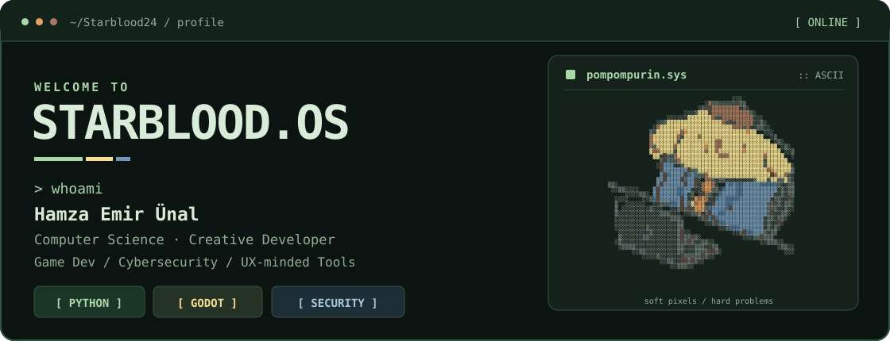
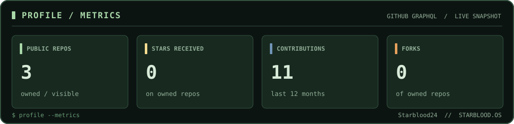
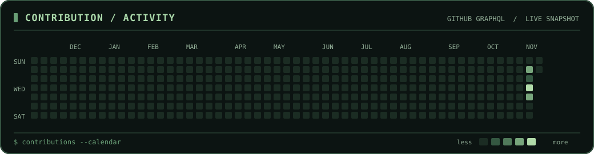
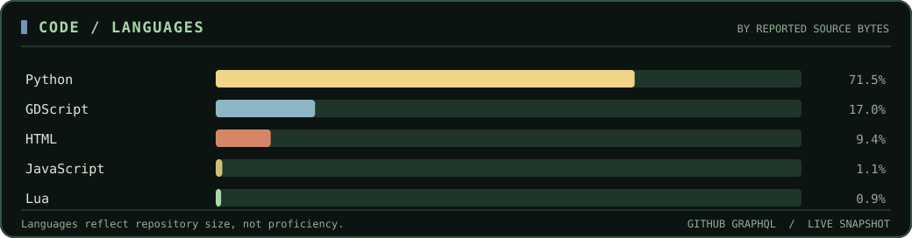
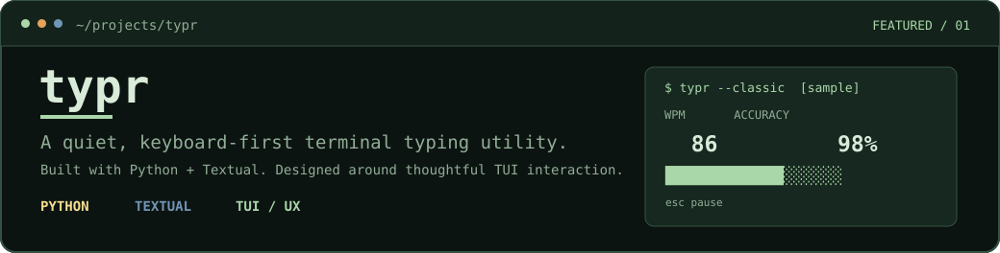
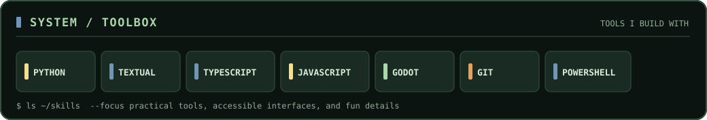
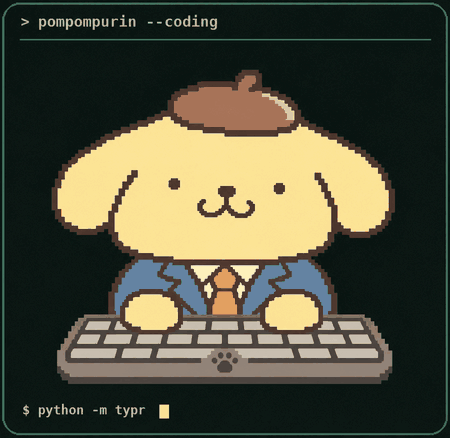

<!-- STARBLOOD.OS — original illustrated profile art + own GitHub GraphQL statistics -->

  <picture>
    <source media="(max-width: 640px)" srcset="./assets/hero_mobile.svg" />
    
  </picture>

### `> about.exe`

Hi, I'm **Emir** — a Computer Science master's student at **RWTH Aachen** who likes building useful software with personality.

I gravitate toward **game development**, **cybersecurity**, developer tools, and the little UX details that make an interface feel right. Currently exploring terminal interfaces, playful interactions, and creative coding.

### `> github --telemetry`

  <picture>
    <source media="(max-width: 640px)" srcset="./assets/stats_mobile.svg" />
    
  </picture>

  <picture>
    <source media="(max-width: 640px)" srcset="./assets/contributions_mobile.svg" />
    
  </picture>

  <picture>
    <source media="(max-width: 640px)" srcset="./assets/languages_mobile.svg" />
    
  </picture>

Data comes from the GitHub GraphQL API. Generated daily via GitHub Actions. Contributions are contributions, not commit counts. Languages represent public repository source bytes, not skill proficiency. If you see “AWAITING FIRST API RUN,” start the workflow once after creating the profile repository.

### `> cat ~/featured/typr`

<a href="https://github.com/Starblood24/typr">
  <picture>
    <source media="(max-width: 640px)" srcset="./assets/featured_typr_mobile.svg" />
    
  </picture>
</a>

### `> ls ~/toolbox`

  <picture>
    <source media="(max-width: 640px)" srcset="./assets/stack_mobile.svg" />
    
  </picture>

### `> ./pompompurin --idle`

  <picture>
    <source media="(prefers-reduced-motion: reduce)" srcset="./assets/pompompurin_idle_poster.png" />
    
  </picture>

  <code>soft pixels · hard problems</code> &nbsp; | &nbsp; <a href="https://github.com/Starblood24/typr">try typr</a>

